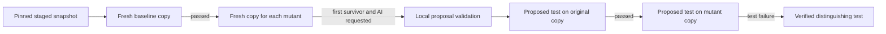

# Team walkthrough

## Why start here?
Mutation testing needs exact file and line scope. Reviewing working-directory
edits while claiming to review the staged commit would make later results false.
We first establish a small, explicit read-only contract.

## Data flow
Terminal arguments -> main -> inspect_repository -> bounded Git commands ->
ChangedFile/SkippedFile records -> Inspection -> human output or JSON.

## How changed lines work
`git diff --cached --unified=0` compares HEAD with the staged index, without
unchanged context. A hunk header `@@ -8,2 +8,3 @@` says the new version has three
changed lines starting at 8. A new-side count of zero means deletion only.
The helper reads hunk headers, not source code. AST mutation selection follows
below.

## Design decisions
- Functions instead of service classes: these operations have no persistent state.
- Dataclasses: explicit immutable data contracts shared with later modules.
- Git handles Git: no custom index parser and no new Git-library dependency.
- NUL-delimited paths plus literal pathspecs: spaces, newlines and brackets do not
  split paths or become wildcard expressions. Terminal paths are escaped.
- Refuse mixed tracked edits: simpler initial scope; no automatic staging.
- No raw subprocess errors: avoid accidentally displaying repository content.

## Questions each owner should be able to answer
1. What differs between HEAD, index, and working tree?
2. Why does a deletion have no new lines to mutate?
3. Why is a successful inspection not a successful review?
4. Why can a disposable directory not safely execute untrusted code?
5. What would become stale if a user edits files after inspection?

## Original next slice (now completed)
Export the exact staged snapshot, verify fidelity, run a trusted fixture's baseline
with bounded execution, and classify failures. Only then add the mutation engine.

## Inspection hardening

`inspect_repository` resolves HEAD and writes an immutable index tree, then asks
Git to compare those two object IDs. Paths and line numbers therefore describe
the same staged version. `git write-tree` stores tree objects; it does not stage,
commit, or change working files. Conflicts and mixed tracked edits still fail.

Run: `python3 -m unittest discover -s tests -v` (13 tests at this step).

Questions: Why pin both comparison endpoints? Why does deletion-only code have
no mutation lines? How do literal pathspecs differ from shell escaping?

## Snapshot export

Inspection tree ID -> `ls-tree` entries -> mode/path validation -> `cat-file`
blob bytes -> temporary directory. `staged_snapshot` is a context manager:
leaving its `with` block removes files even if its consumer raises an error.
No archive, checkout filters, ignored files or untracked files are copied.
One Git subprocess per blob favors understandable code over large-repo speed.

Run: `python3 -m unittest discover -s tests -v` (16 tests at this step).
Questions: Why not copy the working tree? Why reject an unchanged symlink?
Who removes the snapshot when execution fails?

## Bounded pytest execution

Test paths -> `run_tests` -> fresh process session -> pytest hooks -> small JSON
counts -> `TestRun`. The hook counts failed test calls separately from collection,
fixture setup and teardown errors. Missing evidence is an execution error, never
a killed mutant. The runner discards console output, disables ambient plugin
autoload, and kills the process group on timeout and after normal completion.
Already-installed pytest and project dependencies are required; detached child
processes are unsupported. Windows execution returns an error.

Run: `python3 -m unittest discover -s tests -p test_runner.py -v` using an
interpreter with pytest. Four tests cover multiple real subprocess outcomes.
Questions: Why is pytest exit 1 insufficient? Why must no-tests block mutation?
What happens to a child process when its parent times out?

## AST discovery and generation

Changed files/lines + staged snapshot -> `discover_mutations` -> sorted evidence
records. `generate_mutant` reparses original source for each record, checks its
location and expression text, changes one node, unparses, and compiles. It never
uses the previous mutant as input. Multiline expressions qualify when any of
their lines changed. Chained comparisons and tests are skipped. Authentication
or sensitive text cues conservatively exclude whole files; this heuristic cannot
understand business security rules. Review target code before using the tool.

Unparsing discards comments and formatting; generated files use UTF-8. This keeps
the transformation simple at the cost of readable source diffs.
Run: `python3 -m unittest discover -s tests -p test_mutations.py -v`.
Questions: Why not replace strings? Why parse original code for every mutant?
Why can a multiline expression start before its changed line?

## Analysis and reports

`analyze_repository` inspects and exports once, tests a disposable baseline copy,
and stops unless tests pass. Discovery returns sorted candidates; the first five
each run in their own fresh copy. `run_mutant_tests` maps actual test failures to
killed, successful runs to survived, and other problems to excluded outcomes.
`reporting.py` produces terminal/JSON data and exit 0/1/2. No survivors means
only that these chosen mutations were not observed to survive; it is not safety.

Run: `python3 -m ghost_pr run --repo /path/to/trusted/repo --test tests --json`.
Repeat `--test` for multiple selected paths. JSON adds outcome counts and a
`detection_ratio` number or null. A failed or empty baseline produces no mutants.

Questions: How would accumulated mutations corrupt results? Why are timeout and
execution_error excluded from the denominator? When does exit 2 override exit 1?

## Optional local AI and verification

`build_context` reads the pristine snapshot, finds the enclosing function, and
selects small test excerpts. It refuses sensitive paths, suspected credentials
and oversized context before a request. `request_proposal` checks the installed
model list and sends one Ollama chat request. `validate_proposal` checks JSON,
field sizes, Python syntax and the simple test shape. It rejects explicit
process/install imports and dynamic execution; this is not a sandbox.

`verify_proposal` asks `run_snapshot_tests` for two separate disposable copies.
It writes only `test_ghost_proposed.py` inside each copy. First that test must pass
on original code; then it must fail as a test call on the intended mutant.
Import/fixture errors or a timeout do not verify anything. The existing tests
are not mixed into these two runs, so an unrelated failure cannot be mistaken
for a failure in the new test. Verification does not adopt or save the test.



Commands, from the tool root:

```bash
python -m unittest discover -s tests -p test_local_ai.py -v
python -m unittest discover -s tests -p test_ai_verification.py -v
```

These tests use labelled recorded responses and real pytest processes; they do
not establish live model quality. On a fresh demo with a surviving mutant, opt
into real inference with `ghost run --repo PATH --test test_bank.py --ai-model
EXACT_INSTALLED_NAME --show-ai-test`. There is no automatic model download.
The official chat/tags API and local-only server setting are linked in README.

Questions:

1. Why are shape/syntax checks insufficient to trust generated Python?
2. Why must original pass before checking mutant failure, and why test only the
   proposed file for verification?
3. Why does a verified proposal leave the core report's survivor count unchanged?

## The index-byte correction

A deeper check found that `git write-tree` updated index cache metadata even
though `git ls-files --stage` output stayed identical. `pin_index` now copies the
real index to a temporary file and passes its path through `GIT_INDEX_FILE`.
Git may create immutable tree objects, but cannot refresh the original index.
Optional writes, hooks and fsmonitor are disabled for inspection commands.
Raw-byte regression tests cover both inspection and a complete analysis.

Questions: What does a cache-tree extension change? Why isn't comparing staged
paths enough to establish read-only behavior? What remains unsupported if the
index is being changed while its initial copy is made?

## Four-person ownership and debugging

| Owner | First responsibility | Explain to a teammate |
| --- | --- | --- |
| 1 | `repository.py`, Git fixtures | HEAD/index/working tree, pinning, path handling |
| 2 | `mutations.py`, AST tests | Changed-line intersection and one-node replacement |
| 3 | `runner.py`, pytest evidence | Process groups, timeouts and failure phases |
| 4 | CLI, reports, optional AI and demo | Exit codes and two-direction verification |

Rotate reviews so every person can trace the full run. Use the unit tests as
small debugging fixtures; put a breakpoint in one function before adding new
behavior. For pytest failures in a controlled demo, run pytest directly inside
the fixture, then compare the reported mutation expression. The tool deliberately
does not keep run copies or raw logs.

The team has now reported one successful live local-model example. Broader
model/platform reliability remains unmeasured; no speed, coverage or safety
claim is implied. See `docs/DEMO.md` for the observed result, timed rehearsal
and manual adoption steps.

## Prompt correction: distinguish behavior, not just describe it

The team reported that live qwen2.5-coder:3b described equality but repeated an
existing unequal-input test. `request_proposal` now explicitly asks for inputs
that reach the mutation, a different case from ineffective existing tests, and
an assertion on different observable behavior. Comparison guidance mentions
boundary values and relevant equality without prescribing demo values. Tests
must import the real target, not replace or mock it; explanations must match code.
The context, JSON shape, model settings and verifier remain the same.

Input -> actual function, mutation and existing tests. Output -> explanation and
test_code. Execution -> original must pass, intended mutant must fail through a
test failure. The existing verification regression now repeats a partial test
with an equality explanation and confirms that two passes remain unverified.
Five adapter tests and two verification tests pass; this does not prove improved
live generation.

Run in macOS Terminal from the Ghost-PR root, using the existing interpreter
with pytest. This creates a new fixture containing only the initial test:

```bash
GHOST_DEMO_DIR="$(mktemp -d)/withdrawal"
/private/tmp/ghost-pr-dev/bin/python examples/create_demo.py "$GHOST_DEMO_DIR"
/private/tmp/ghost-pr-dev/bin/python -m ghost_pr run \
  --repo "$GHOST_DEMO_DIR" --test test_bank.py --max-mutants 1 \
  --ai-model qwen2.5-coder:3b --ai-endpoint http://127.0.0.1:11434 \
  --json --show-ai-test
```

Check ai.response_received, ai.original.status and ai.mutant.status. Only original
passed plus mutant failed earns verified_distinguishing_test. A both-pass proposal
stays unverified. Core exit 1 remains expected for the original survivor even
when a new proposal distinguishes it. Do not append the prepared boundary test.

Questions: Why can a correct explanation accompany an ineffective test? When
does equality matter to a comparison mutation? Why must execution, rather than
the prompt or model explanation, decide verification?

## Teammate 1 — Git scope and snapshots

Own `repository.py`; shared result shapes live in `models.py`. Explain:
“I read staged paths and new-side lines, pin the index using a temporary index
copy, then export Git blob bytes. Every later run starts from that pinned tree,
while the contributor's files and index stay intact.”

Three likely judge questions:

1. **Why staged changes?** They describe the intended contribution. Working-tree
   changes may be different; the MVP rejects mixed tracked edits and excludes
   untracked/ignored files.
2. **How do you keep snapshots exact without altering the index?** Resolve HEAD,
   copy the index, write an immutable tree from the copy, validate every tree
   entry, and export regular blobs directly. Index caches can change during
   write-tree, so using a temporary index matters. Initial concurrent capture
   is unsupported; later edits cannot change the pinned tree.
3. **What about unusual or unsafe paths?** Git output uses NUL delimiters and
   literal pathspecs. Snapshot export rejects traversal, .git paths, symlinks
   and submodules, including unchanged unsupported entries.

## Teammate 2 — AST mutation discovery and generation

Own `mutations.py`. Explain: “I parse staged Python, select supported expressions
intersecting changed lines, and record each before/after change. I reparse the
original source for every mutant, change one node, unparse and compile it.”

Three likely judge questions:

1. **Why AST instead of string replacement?** AST identifies expression types
   and locations without accidentally changing matching text in comments or
   strings. The tradeoff is that unparsing changes formatting and comments.
2. **How do you limit scope?** Use changed-line intersections, deterministic
   ordering and at most five mutants. Operators are <= to <, >= to >, == to !=
   and Boolean flips. Tests and chained comparisons are skipped. Sensitive-code
   cues conservatively exclude files; the heuristic is not semantic analysis.
3. **Why not accumulate mutations?** Then a failure could be caused by another
   change. Each fresh AST and disposable copy contains one independent mutation.
   A survivor can be equivalent or unexercised; it does not automatically prove
   that a test is missing.

## Teammate 3 — Bounded test execution and evidence

Own `runner.py` and `pytest_evidence.py`. Explain: “I run selected pytest paths
with the current Python interpreter, enforce a timeout, and collect small
phase-specific counts. I distinguish failed test calls from collection and
fixture problems, and clean up the process group.”

Three likely judge questions:

1. **Why must the baseline pass first?** Otherwise a failure might already exist
   before mutation. An empty, entirely skipped, failed or errored baseline blocks
   analysis; it cannot establish test sensitivity.
2. **Does every nonzero pytest exit kill a mutant?** No. Killed requires a real
   call-phase test failure after a passing baseline. Collection/import/setup/
   teardown/internal errors are execution_error; timeout is separate. Structured
   hook counts are needed because an exit code alone is insufficient.
3. **Are temporary copies secure sandboxes?** No. Trusted projects/dependencies
   can still affect external state. On macOS/Linux we kill the process group on
   timeout and completion; detached processes escaping it are unsupported.
   Context managers remove test copies even on failures.

## Teammate 4 — CLI, optional AI and honest reporting

Own orchestration in `cli.py`, requests/validation in `local_ai.py`, and output
in `reporting.py`. Explain: “I connect the stages and report observed evidence.
AI is optional: it proposes one test for the first survivor, then the verifier
requires original pass and intended-mutant test failure in separate copies.”

Three likely judge questions:

1. **What does AI receive, and what do you trust?** The actual enclosing function,
   mutation and small existing-test excerpts, screened and bounded. It returns
   explanation/test_code JSON. Shape and syntax checks do not prove correctness;
   execution decides verification, followed by manual review of intent. No
   target replacement, automatic adoption, model download or shell installation
   is part of the workflow.
2. **Why exit 1 after a verified proposal?** The existing tests still missed the
   mutant. Verification has not adopted the new test. After manual review, save
   the generated test, stage it, and rerun both test paths. A newly observed killed
   result then changes the report. Exit 2 takes precedence for operational errors.
3. **What does the successful live demo establish?** The team observed a
   distinguishing test from qwen2.5-coder:3b for this fixture. It does not establish
   general model reliability or business requirements. The detection ratio is
   killed/(killed+survived), excluding timeout/error, with N/A for zero denominator;
   it is never a safety score.
